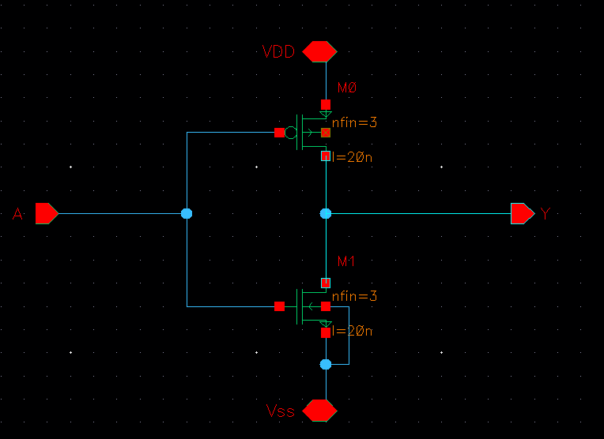
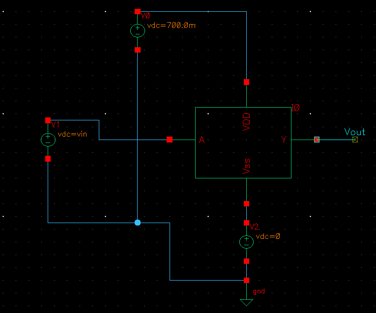
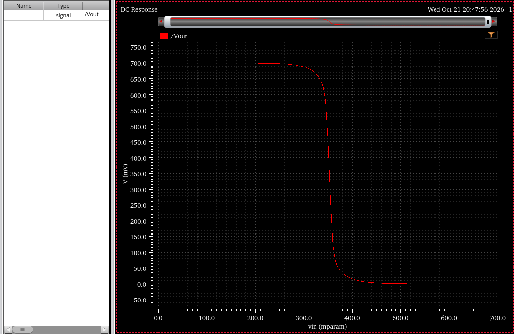
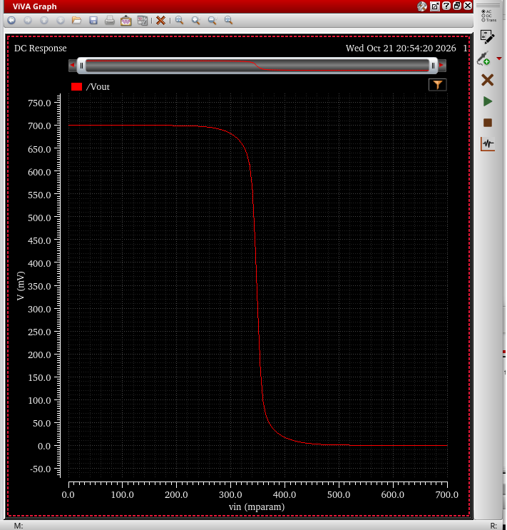
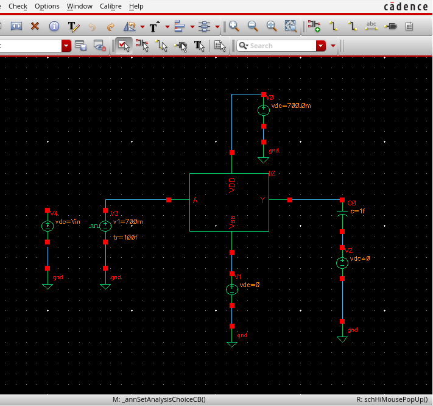
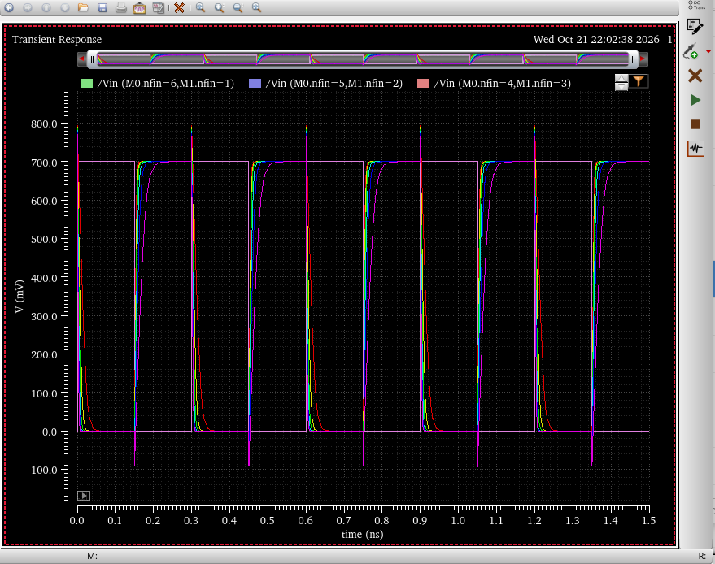
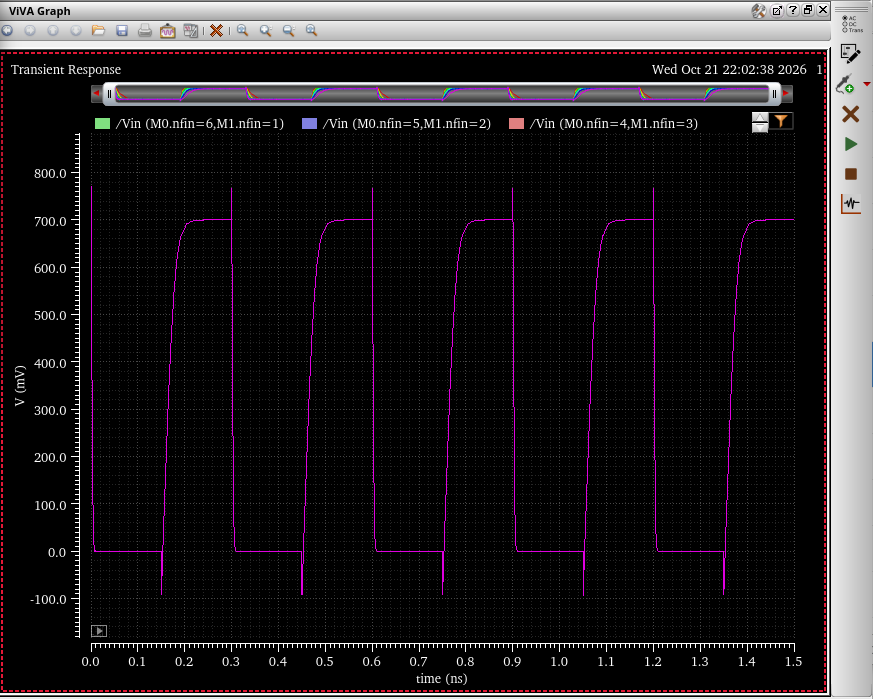
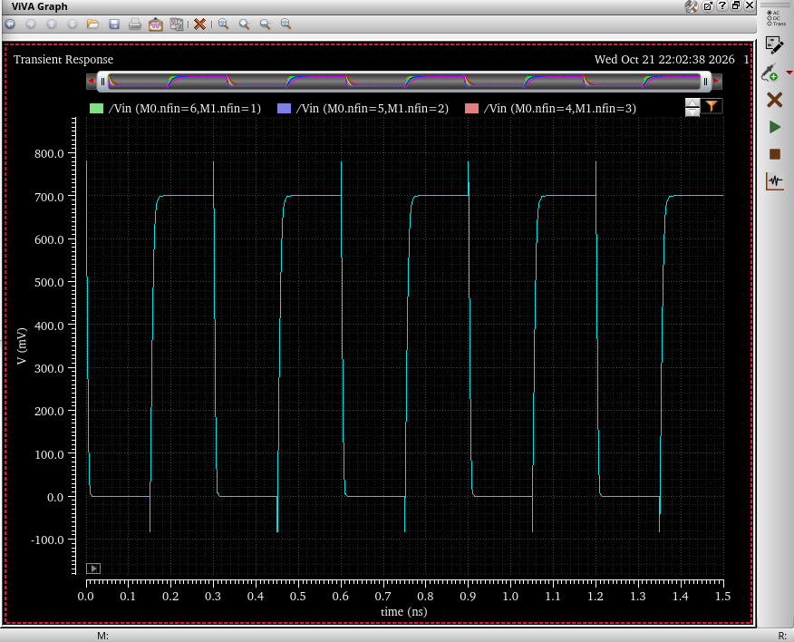
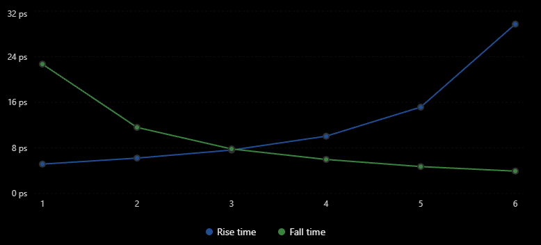

# CMOS Inverter Design and Timing Optimization

**Fall 2026**

Transistor-level design, simulation, and sizing optimization of a CMOS inverter built from ASAP7 7 nm FinFET devices. The work covers DC voltage transfer characteristics, process corner comparison, transient rise/fall optimization under capacitive load, and a seven-stage ring oscillator built from the same inverter cell.

## Contents

1. [Project Overview](#1-project-overview)
2. [Design Environment](#2-design-environment)
3. [DC Voltage Transfer Characteristics](#3-dc-voltage-transfer-characteristics)
4. [Process Corner Analysis](#4-process-corner-analysis)
5. [Transient Timing Optimization](#5-transient-timing-optimization)
6. [Ring Oscillator Design](#6-ring-oscillator-design)
7. [Results and Engineering Observations](#7-results-and-engineering-observations)
8. [Key Engineering Takeaways](#8-key-engineering-takeaways)
9. [Project Status](#9-project-status)
10. [Image Gallery](#10-image-gallery)

---

## 1. Project Overview

This project investigates the behavior of a static CMOS inverter implemented with FinFET transistors from the ASAP7 7 nm predictive process design kit. The objective was to build an intuition, backed by simulation, for how three things shape inverter behavior and switching performance:

- **Transistor sizing**, expressed as the number of fins allocated to the NMOS and PMOS devices
- **Process variation**, represented by the TT, SS, and FF device model corners
- **Capacitive loading** at the inverter output

I designed the inverter schematic and symbol in Cadence Virtuoso, built separate DC and transient testbenches around it, ran the simulations through ADE Explorer with HSPICE as the circuit simulator, and extracted the measurements with Cadence ViVA.

The project consists of four investigations:

| # | Investigation | Question answered |
|---|---|---|
| 1 | DC switching characteristics and transistor sizing | How does the PMOS fin count move the switching threshold? |
| 2 | Process corner analysis | How do SS and FF device models change the transfer curve relative to TT? |
| 3 | Transient timing optimization | Which NMOS/PMOS fin split gives the most symmetric rise and fall times into a 1 fF load? |
| 4 | Ring oscillator design | Does a seven-stage loop of the inverter self-oscillate, and at what rate? |

---

## 2. Design Environment

| Parameter | Value |
|---|---|
| Technology | ASAP7 7 nm (predictive FinFET PDK) |
| Circuit Type | Static CMOS inverter |
| Transistor Type | FinFET, 20 nm drawn gate length |
| Schematic Editor | Cadence Virtuoso |
| Simulation Environment | Cadence ADE Explorer |
| Circuit Simulator | HSPICE |
| Waveform Analysis | Cadence ViVA and ViVA Calculator |
| Supply Voltage | 0.7 V |
| Project Period | Fall 2026 |

### Simulation workflow

Every investigation followed the same loop:

1. **Schematic design.** Draw the inverter from the ASAP7 NMOS and PMOS FinFET primitives, assign fin counts, and generate a symbol so the cell can be instantiated in testbenches.
2. **Testbench configuration.** Instantiate the symbol, add supply, stimulus, and load elements, and expose the quantities to be swept (input voltage, fin counts) as design variables or device parameters.
3. **Process model selection.** Point ADE Explorer at the TT, SS, or FF model section of the ASAP7 library.
4. **Simulation.** Run a DC sweep or a transient analysis through HSPICE, with parametric sweeps where several sizings were compared in one run.
5. **Waveform analysis.** Plot the results in ViVA and use the ViVA Calculator to extract rise time, fall time, and crossing points.
6. **Optimization.** Compare the extracted numbers across the sweep and select the sizing that best meets the goal.

---

## 3. DC Voltage Transfer Characteristics

### Inverter cell

The inverter is the conventional two-transistor static CMOS topology: a PMOS pull-up between `VDD` and the output `Y`, and an NMOS pull-down between `Y` and `Vss`, with both gates driven by the input `A`. Both devices are drawn with a 20 nm gate length. In the baseline cell each device has three fins.

| Inverter schematic | DC testbench |
|---|---|
|  |  |

*Left: the inverter cell, PMOS on top (nfin = 3, l = 20 nm) and NMOS below (nfin = 3, l = 20 nm). Right: the DC testbench wraps the inverter symbol with a 0.7 V supply, a 0 V source on the Vss rail, and an input source whose value is the design variable `vin`.*

### DC simulation configuration

| Parameter | Value |
|---|---|
| Supply voltage | 0.7 V |
| NMOS fin count | 3 (fixed) |
| PMOS fin count | Swept 1, 2, 3, 4, 5, 6 |
| Process corner | TT |
| Analysis | DC sweep of the input voltage `vin` from 0 V to 0.7 V |

The simulation produces the voltage transfer characteristic (VTC), the static mapping from input to output voltage:

$$
V_{out} = f(V_{in})
$$

For a symmetric inverter the logical switching threshold, the input voltage at which $V_{out} = V_{in}$, sits at the middle of the supply:

$$
V_M \approx \frac{V_{DD}}{2} = 0.35\ \text{V}
$$

### Results

*Parametric DC sweep in ADE Explorer. The results pane on the left lists the six sweep points (PMOS fin count 1 through 6). Each curve is the full 0 V to 0.7 V transfer characteristic for one fin count; the legend identifies the first four traces (red = 1 fin, yellow = 2, green = 3, cyan = 4), and the blue and magenta traces are the 5- and 6-fin cases.*

All six curves show the expected static CMOS behavior: a solid logic-high output of 0.7 V for low inputs, a solid logic-low output near 0 V for high inputs, and a steep transition region. What changes with PMOS fin count is **where** that transition happens. With a single PMOS fin the curve switches at the lowest input voltage of the family, and each added fin pushes the transition to the right. The whole family falls within roughly the 300 mV to 400 mV input range, bracketing the 350 mV midpoint.

### Why the PMOS fin count moves the threshold

At the switching point both transistors are saturated and conduct the same current. The input voltage at which that balance occurs depends on the ratio of pull-up strength to pull-down strength. Adding fins to the PMOS raises its drive current for a given gate overdrive, so a larger input voltage (more NMOS overdrive, less PMOS overdrive) is required before the NMOS can sink what the PMOS sources. The threshold therefore shifts upward with PMOS fin count, and would shift downward if fins were added to the NMOS instead.

Balancing pull-up and pull-down strength matters for more than the DC threshold. A centered $V_M$ gives the largest and most symmetric noise margins, and, as the transient investigation below shows, it is also tied to symmetric rise and fall behavior. Because hole mobility is lower than electron mobility, a balanced inverter normally needs a somewhat stronger PMOS than NMOS. In a FinFET process that strength is quantized: fin count is the only width knob, so the achievable ratios are discrete.

> **Note on the DC optimum.** The sweep clearly shows the threshold moving through the 0.35 V target as the PMOS fin count increases, but the exact fin count that landed closest to $V_{DD}/2$ was not preserved in the numerical records from this investigation. I have not reconstructed a value from the plot, so no DC-optimal fin ratio is claimed here.

---

## 4. Process Corner Analysis

The same inverter testbench was re-simulated with the slow and fast ASAP7 model sections to see how manufacturing variation changes the transfer characteristic.

| Corner | Description |
|---|---|
| TT | Typical NMOS and typical PMOS |
| SS | Slow NMOS and slow PMOS |
| FF | Fast NMOS and fast PMOS |

A process corner is a model set that captures how threshold voltage, effective channel length, oxide thickness, and mobility can drift during fabrication. At the **SS** corner the devices have higher threshold voltages and lower drive current, so a given input produces less current and transitions are more sluggish. At the **FF** corner threshold voltages are lower and drive currents higher. Because SS and FF push the NMOS and PMOS in the same direction, the pull-up to pull-down ratio stays roughly constant and the switching threshold stays near the center; the corners that move $V_M$ most are the skewed ones (SF and FS), which were not part of this investigation.

| SS corner | FF corner |
|---|---|
|  |  |

*Voltage transfer characteristics at the slow-slow (left) and fast-fast (right) corners. Both curves retain full rail-to-rail swing and a steep transition region in the vicinity of 350 mV. The typical-corner reference is the 3-fin trace in the DC sweep of Section 3.*

### DC behavior versus transient speed

The three VTC plots describe only the **static** operating points of the inverter. The curves at SS and FF look similar to TT because a DC sweep holds the input at each voltage until the circuit settles, so it does not expose how long the settling takes. The corner differences that matter most to a digital designer, delay and edge rate, come from drive current charging and discharging a load capacitance over time, which is a transient quantity.

A VTC plot therefore cannot by itself establish propagation delay, and it does not confirm that the FF corner switches faster in a transient measurement. Confirming that would require re-running the transient timing analysis of Section 5 at each corner, which was not done in this project. The corner comparison here is limited to the static characteristic.

---

## 5. Transient Timing Optimization

This is the core of the project and holds its strongest verified measurements. The question was: given a fixed budget of seven fins to split between the NMOS and PMOS devices, which allocation produces the most symmetric output rise and fall times into a 1 fF load?

### Transient testbench

*The transient testbench. A pulse source (high level 0.7 V, rise time 100 fs) drives the input `A`; the output `Y` drives a 1 fF capacitor. The 0 V source in series with the load returns the capacitor to ground while providing a node for probing load current. A leftover DC input source from the DC testbench sits unconnected on the left.*

| Parameter | Value |
|---|---|
| Supply voltage | 0.7 V |
| Load capacitance | 1 fF |
| Input signal | Pulse, 0 V to 0.7 V |
| Pulse period | 300 ps |
| Input rise time | 100 fs |
| Input fall time | 100 fs |
| Total fins | Nn + Np = 7 |
| Process corner | TT |
| Analysis | Transient, parametric over the fin split |

The near-ideal 100 fs input edges mean the measured output edges are set almost entirely by the inverter driving the load, not by the stimulus.

### Measurement definitions

Output rise and fall times are measured between the 10% and 90% points of the supply:

$$
t_r = t\,(V_{out} = 0.9\,V_{DD}) - t\,(V_{out} = 0.1\,V_{DD}),
\qquad
t_f = t\,(V_{out} = 0.1\,V_{DD}) - t\,(V_{out} = 0.9\,V_{DD})
$$

With $V_{DD} = 0.7$ V the thresholds are 70 mV and 630 mV. These were extracted with the ViVA Calculator rise-time and fall-time functions on each output waveform.

### Six sizing configurations

*All six fin splits overlaid in one parametric transient run, 1.5 ns window, five 300 ps periods. The square trace is the input pulse. The spread between traces is much larger on the rising edges than on the falling edges, because the rising edge is set by PMOS fin count, which ranges from 1 to 6 across the sweep, while every configuration keeps a reasonably strong pull-down.*

Two individual configurations are shown below, isolated from the overlay.

*Nn = 6, Np = 1. With a single PMOS fin the pull-up is far weaker than the pull-down. The rising edge is visibly RC-shaped and slow, while the falling edge is almost vertical. This is the most asymmetric case in the sweep: 29.720 ps rise versus 3.926 ps fall.*

*Nn = 4, Np = 3. Three PMOS fins bring the rising edge much closer to the falling edge (10.060 ps rise versus 5.975 ps fall), but the pull-up is still the slower path.*

### Measured results

| NMOS Fins | PMOS Fins | Rise Time (ps) | Fall Time (ps) | Difference (ps) |
|---|---|---|---|---|
| 6 | 1 | 29.720 | 3.926 | 25.794 |
| 5 | 2 | 15.160 | 4.721 | 10.439 |
| 4 | 3 | 10.060 | 5.975 | 4.085 |
| **3** | **4** | **7.625** | **7.818** | **0.193** |
| 2 | 5 | 6.214 | 11.600 | 5.386 |
| 1 | 6 | 5.160 | 22.700 | 17.540 |

*Difference is the absolute value of rise time minus fall time.*

*Rise and fall time across the six configurations, plotted from the table above. The two curves cross almost exactly at Nn = 3, Np = 4.*

*The working plot I produced during the investigation, with NMOS fin count on the horizontal axis (PMOS fin count is 7 minus that value). It shows the same crossing at three NMOS fins.*

### Interpretation

- **Fall time tracks NMOS strength.** The output falls when the NMOS discharges the load capacitor to ground. Going from one to six NMOS fins cuts the fall time from 22.700 ps to 3.926 ps, a monotonic improvement with each added fin.
- **Rise time tracks PMOS strength.** The output rises when the PMOS charges the load from the supply. Going from one to six PMOS fins cuts the rise time from 29.720 ps to 5.160 ps.
- **PMOS needs more fins than NMOS for symmetry.** At a near-equal split the rise is still slower than the fall (Nn = 4, Np = 3 gives 10.060 ps versus 5.975 ps). Hole mobility in the PMOS channel is lower than electron mobility in the NMOS channel, so matching drive strength takes extra PMOS fins. The crossing lands at four PMOS fins against three NMOS fins.
- **Sizing is a zero-sum tradeoff under a fin budget.** Every fin moved to the PMOS speeds up the rise and slows the fall. The extreme splits (6/1 and 1/6) make one edge very fast at the cost of the other being 4 to 7 times slower, which is rarely useful for a logic gate whose worst-case edge sets the timing.
- **Capacitive loading sets the scale.** Every edge time here is the time for a device of a given strength to move 1 fF through 80% of the supply. A larger load would stretch all six rows proportionally, and the balance point would stay at the same ratio, because both edges scale with the same capacitance.
- **Timing symmetry.** Matched rise and fall times mean the gate adds the same delay to a rising transition as to a falling one, which simplifies timing closure in a path containing many such gates and keeps duty cycle intact through a chain of inverters.

### Best configuration

**NMOS = 3 fins, PMOS = 4 fins**

| Metric | Value |
|---|---|
| Rise time | 7.625 ps |
| Fall time | 7.818 ps |
| Difference | 0.193 ps |

This configuration minimizes the absolute rise/fall difference among the six tested combinations. Its edges are within 2.5% of each other. The next-best split (Nn = 4, Np = 3) is more than twenty times less balanced at 4.085 ps.

### Propagation delay

Rise time, fall time, and propagation delay are different measurements. Rise and fall times describe how long one output edge takes between the 10% and 90% levels. Propagation delay describes the lag from an input crossing 50% of the supply to the output crossing 50%, and is measured separately for each output direction:

- $t_{pHL}$: input rising, output falling
- $t_{pLH}$: input falling, output rising

The average propagation delay is

$$
t_p = \frac{t_{pHL} + t_{pLH}}{2}
$$

The measurement procedure was identified for this testbench (ViVA Calculator delay function between the 50% crossing of `A` and the 50% crossing of `Y`, for each edge direction), but a verified numerical propagation delay result was not recorded. **No propagation delay value is reported for this project.** Only the rise and fall times above are measured results.

---

## 6. Ring Oscillator Design

### Principle of operation

A ring oscillator is a closed loop of an odd number of inverting stages. Because the loop inverts an odd number of times, there is no stable DC state: whatever logic value is at the input of the first stage, the loop returns its complement after one trip around. Each stage takes one propagation delay to respond, so the signal keeps circulating and the output toggles. One full period requires two trips around the loop (one to flip the output, one to flip it back), giving

$$
f \approx \frac{1}{2 N t_p}
$$

where

- $N$ = number of inverter stages
- $t_p$ = average propagation delay of one stage, loaded by the next stage's gate capacitance
- $f$ = oscillation frequency

Ring oscillators are widely used as on-chip process monitors precisely because the frequency is a direct readout of inverter delay.

### Circuit design and setup

*The seven-stage ring oscillator cell. Seven instances of the inverter symbol are chained left to right along shared VDD (top) and Vss (bottom) rails, and the output of the seventh stage is routed back to the input of the first. The ViVA pane on the right shows the transient output over the 2 ns window.*

| Parameter | Value |
|---|---|
| Stages | 7 |
| Stage cell | The CMOS inverter symbol from Sections 3 to 5 |
| Topology | Closed-loop feedback, last output to first input |
| Process corner | TT |
| Supply voltage | 0.7 V |
| Transient duration | 2 ns |
| Maximum simulation step | 0.5 ps |
| Initial condition | Attempted `Vout(0) = 0 V` on the output node |

### Observed behavior

In the first transient run the output did not oscillate. It settled at approximately 0.7 V and stayed there for the full 2 ns window, as the flat trace in the screenshot shows. This is a familiar simulator artifact rather than a circuit property: a perfectly symmetric ring with no noise and no initial-condition asymmetry can sit at a metastable operating point where every node is at the same intermediate voltage, or can be driven by the simulator's DC operating-point solution into a state it never leaves. In real silicon, noise guarantees startup.

To break the symmetry I modified the setup to apply an initial condition of 0 V on the output node, which is the standard way to kick a simulated ring oscillator. **Sustained oscillation had not yet been verified in the available results.** The frequency measurement that would close the loop between the inverter delay and the ring frequency is therefore still pending, and no oscillation frequency is reported.

### Conceptual extensions

The following configurations were analyzed from the delay relationship above but were **not simulated** in this project.

| Configuration | Expected behavior |
|---|---|
| 7-stage ring | Baseline. $f \approx 1 / (14\,t_p)$. |
| 9-stage ring | Oscillates. Period grows to $18\,t_p$, so the frequency drops to roughly 7/9 of the 7-stage value. |
| 11-stage ring | Oscillates. Period $22\,t_p$, frequency roughly 7/11 of the 7-stage value. |
| Doubled NMOS and PMOS fins in every stage | Each stage has twice the drive current, but also presents twice the gate capacitance to the stage before it. To first order the delay per stage, and hence the frequency, changes only modestly; the dominant effect is higher power. |
| 10 stages (even) | Does not oscillate. An even number of inversions returns the same logic value after one trip, so the loop has two stable states and latches into one of them instead of toggling. |

The even-stage case is the important negative result: an inverter loop with an even stage count is a bistable element (a chain of back-to-back inverters), not an oscillator, which is why ring oscillators always use an odd stage count.

---

## 7. Results and Engineering Observations

### Completed and verified

| Measurement | Result |
|---|---|
| DC transfer curves, PMOS fins 1 to 6, Nn = 3, TT | Six VTC curves generated; switching threshold moves to higher input voltage with each added PMOS fin |
| DC transfer curves at SS and FF | Both corners retain full rail-to-rail swing with a steep transition near 350 mV |
| Transient rise/fall time, six fin splits, 1 fF load | Full table in Section 5; best balance at Nn = 3, Np = 4 with 7.625 ps rise, 7.818 ps fall, 0.193 ps difference |

### Partially completed

| Item | State |
|---|---|
| Seven-stage ring oscillator | Schematic built and simulated for 2 ns; output held at 0.7 V; initial-condition startup fix applied but not yet confirmed |

### Theoretical predictions only (not simulated)

- Frequency scaling for 9- and 11-stage rings relative to the 7-stage ring
- Effect of doubling fin counts in every ring stage
- Non-oscillation of a 10-stage (even) loop

### Measurements not yet recorded

- The PMOS fin count that places the DC switching threshold closest to 0.35 V
- Propagation delay ($t_{pHL}$, $t_{pLH}$, $t_p$) for any sizing
- Rise/fall time or delay at the SS and FF corners
- Ring oscillator frequency

---

## 8. Key Engineering Takeaways

- **Device sizing directly shapes both static and dynamic behavior.** Changing one fin count moves the DC switching threshold and changes one of the two output edge rates, with the other edge nearly unaffected.
- **Transistor sizing under a fin budget is a tradeoff, not a free improvement.** With Nn + Np fixed, every fin given to one device is taken from the other. The sweep makes the cost of each decision explicit in picoseconds.
- **Pull-up and pull-down strength must be balanced deliberately.** Lower hole mobility means the PMOS needs more fins than the NMOS to match, and in a FinFET process the only available ratios are integer ones. Here 4:3 was the closest achievable match.
- **Process variation changes drive current more visibly than it changes the static transfer curve.** The SS and FF VTCs look much like TT; the real impact of corners is on delay, which a DC sweep cannot show.
- **Output load sets the absolute timescale.** All edge times are the time to move the load capacitance through most of the supply range. Relative conclusions about sizing survive a change in load; absolute numbers do not.
- **DC and transient analysis answer different questions.** DC analysis gives thresholds and noise margins; transient analysis gives edge rates and delay. Neither substitutes for the other.
- **Inverter delay and ring oscillator frequency are two views of the same quantity.** Once oscillation is confirmed, measuring the ring frequency is an independent check on the stage delay predicted from the transient testbench, through $f \approx 1/(2 N t_p)$.

---

## 9. Project Status

| Investigation | Status |
|---|---|
| DC switching analysis | VTC sweep completed |
| Process corner comparison | TT, SS, FF curves generated |
| Transient timing optimization | Rise/fall analysis completed |
| Propagation delay extraction | Pending |
| Ring oscillator validation | In progress |

---

## 10. Image Gallery

All simulation screenshots from this project, grouped by investigation. The two timing plots in Section 5 (the generated comparison chart and the original working plot) are not repeated here.

### DC Switching Analysis

| | |
|---|---|
|  |  |
| Inverter cell: 3-fin PMOS, 3-fin NMOS, 20 nm gate length | DC testbench with 0.7 V supply and swept input source |

Parametric DC sweep: voltage transfer curves for PMOS fin counts 1 through 6 at the TT corner.

### Process Corner Comparison

| | |
|---|---|
|  |  |
| Voltage transfer curve, SS corner | Voltage transfer curve, FF corner |

### Transient Timing Analysis

Transient testbench: pulse input, 0.7 V supply, 1 fF output load.

All six NMOS/PMOS fin splits overlaid with the input pulse, 1.5 ns window.

Nn = 6, Np = 1: slow rising edge, fast falling edge.

Nn = 4, Np = 3: rise and fall edges approaching balance.

### Ring Oscillator Design

Seven-stage ring oscillator built from the inverter symbol, with the 2 ns transient result showing the output held at 0.7 V.
