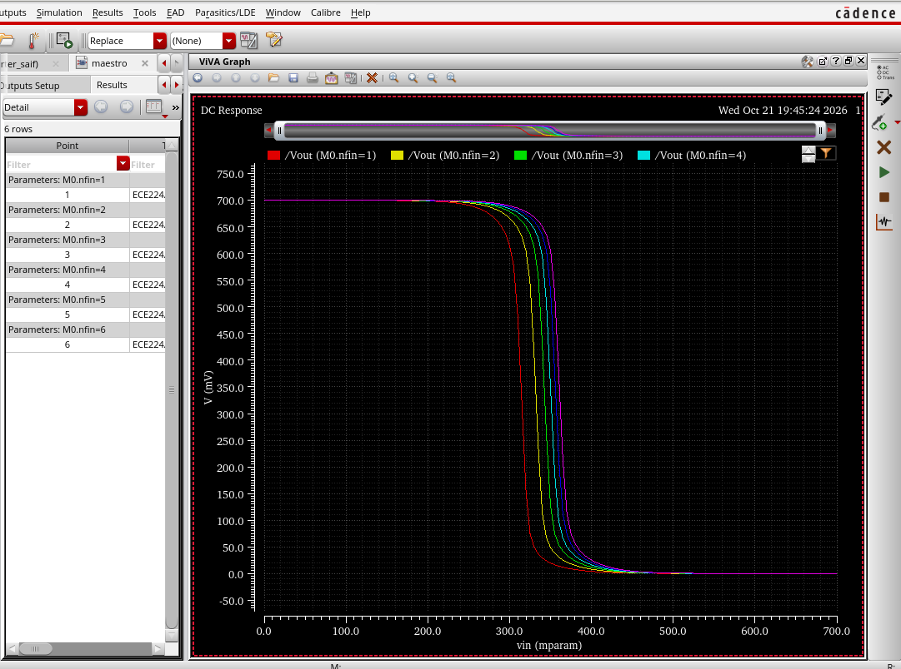
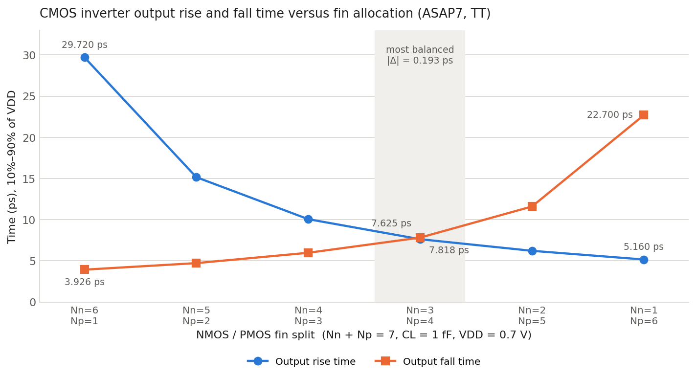
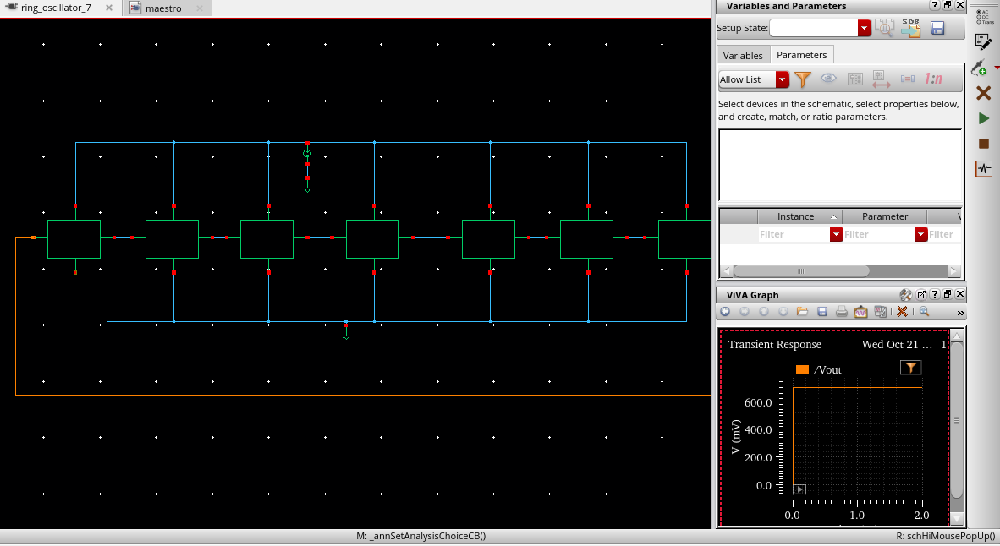

# Digital VLSI Design

Author: Saif Alomari

A collection of transistor-level CMOS design, simulation, and optimization projects. The work began in Fall 2026 and explores how circuit behavior, timing, transistor sizing, and performance respond to design decisions, using industry-standard electronic design automation tools and a 7 nm FinFET predictive process.

Each project directory contains its own detailed README with the design setup, simulation parameters, measured results, and the full set of simulation screenshots.

## Technical Areas

- CMOS digital circuit design
- FinFET transistor sizing
- DC and transient circuit simulation
- Process corner analysis (TT, SS, FF)
- Propagation delay and timing optimization
- Capacitive loading
- Ring oscillator design
- Circuit performance analysis

## Tools and Technologies

| Category | Tool |
|---|---|
| Schematic capture | Cadence Virtuoso |
| Simulation control | Cadence ADE Explorer |
| Waveform measurement | Cadence ViVA Calculator |
| Circuit simulator | HSPICE |
| Process models | ASAP7 7 nm predictive technology models |
| Device types | CMOS and FinFET circuit design |

## Projects

### [Project 01: CMOS Inverter Design and Timing Optimization](Project_01/README.md)

Transistor-level design and characterization of a static CMOS inverter in ASAP7 FinFET technology at a 0.7 V supply. In this project I:

- Designed the CMOS inverter schematic and symbol, plus DC and transient testbenches
- Analyzed the DC voltage transfer characteristic across a sweep of PMOS fin counts
- Investigated how PMOS and NMOS fin allocation moves the switching threshold
- Compared the transfer characteristic at the TT, SS, and FF process corners
- Optimized output rise and fall times under a fixed seven-fin budget into a 1 fF load
- Built a seven-stage ring oscillator from the inverter and began exploring its startup behavior

**Main result.** Among the six NMOS/PMOS fin splits tested, the most balanced configuration was:

| NMOS fins | PMOS fins | Load | Rise time | Fall time | Difference |
|---|---|---|---|---|---|
| 3 | 4 | 1 fF | 7.625 ps | 7.818 ps | 0.193 ps |

The ring oscillator and propagation delay measurements are still in progress; the project README states exactly what has and has not been verified.

## Project Screenshots

*Parametric DC sweep of the inverter voltage transfer characteristic. Each curve is one PMOS fin count from 1 to 6 with the NMOS fixed at 3 fins; the switching threshold moves to a higher input voltage as PMOS fins are added.*

*Measured 10% to 90% output rise and fall times for the six fin splits that sum to seven fins. The curves cross at 3 NMOS and 4 PMOS fins, the most symmetric configuration.*

*Seven-stage ring oscillator assembled from the inverter symbol, with the output of the last stage fed back to the first. The first transient run held at 0.7 V; startup investigation is ongoing.*
